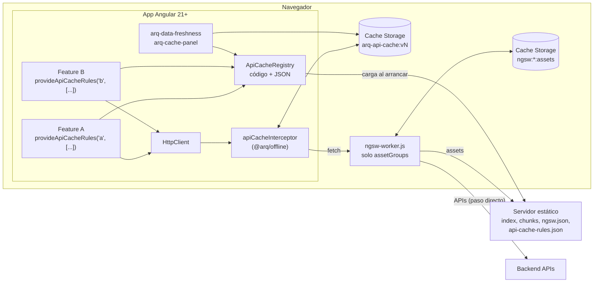

# Plan de implantación · Opción B: NGSW para assets + `arq-offline` para APIs

> Versión 0.1 (borrador para revisión) · 2026-10-07 · Base: [índice](./README.md),
> [`INFORME.md`](../INFORME.md), [`INFORME-continuidad-y-alternativas.md`](../INFORME-continuidad-y-alternativas.md)
> Las estimaciones son orientativas (jornadas-persona) y deben validarse con el equipo.

## 1. Objetivo

Dar a las aplicaciones Angular de la arquitectura:

1. **Arranque offline** de la aplicación (shell, JS/CSS y chunks lazy) con
   `@angular/service-worker`, usado **solo para assets** (D-01).
2. **Caché de APIs declarativa**: cada equipo decide qué llamadas guarda su feature y con qué
   estrategia, mediante reglas `ApiCacheRule` (D-02, D-03).
3. **Visualización**: el usuario ve en modo lectura los últimos datos guardados y sabe de
   cuándo son; los equipos y soporte ven qué se ha guardado y por qué.

Todo ello sin atarse a la evolución de NGSW, que está congelado (H-01). La lógica de APIs no
depende de él y existe una salida probada a Workbox o Serwist (D-04, P-06).

### Fuera de alcance (esta fase)

- Envío diferido de formularios o mutaciones offline (L-02). Requiere una cola propia; se
  propone como iniciativa aparte.
- Notificaciones push.
- Mantener SSR o prerender para usuarios recurrentes (L-07): se acepta CSR desde la caché.
- Cifrado de datos en reposo en el navegador (se evalúa en T-1.9, no se implementa por defecto).

## 2. Arquitectura objetivo



Principios:

- **Una sola fuente de verdad por responsabilidad.** NGSW: ficheros del build. `arq-offline`:
  respuestas de API. NGSW no lleva `dataGroups`, para evitar dos cachés de la misma petición.
- **Los equipos solo declaran reglas.** No programan caché ni acceden a Cache Storage.
- **La arquitectura publica una única API pública:** `provideArqOffline`, `withArqApiCache`,
  `provideApiCacheRules`, `<arq-data-freshness>`, `<arq-cache-panel>`, `cacheMetaOf`,
  `SKIP_API_CACHE` y `ApiCacheStore.clear`.
- **Hay un camino de salida.** El mismo contrato funciona sobre un SW Workbox
  (`provideApiCacheRulesToServiceWorker`).

## 3. Decisiones previas necesarias (Fase 0)

| # | Decisión | Opciones | Propuesta | Responsable |
|---|---|---|---|---|
| Q-1 | Dónde vive la librería | Monorepo de arquitectura (ng-packagr) / repo propio / dentro de cada app | Repo o monorepo de arquitectura, publicada en el registro npm interno como `@arq/offline` | Arquitectura |
| Q-2 | Versión mínima de Angular | 21 / 22 | **21** (LTS hasta 2027-06), probada también en 22 | Arquitectura |
| Q-3 | Navegadores objetivo | Chromium / + Firefox / + Safari-iOS | Definir según el parque real; condiciona la Fase 5 | Producto + Arquitectura |
| Q-4 | Almacenamiento | Cache Storage (prototipo) / IndexedDB (Dexie o idb-keyval) | Cache Storage + índice de metadatos en IndexedDB si el volumen lo exige (T-1.3) | Arquitectura |
| Q-5 | Política de datos sensibles | Lista blanca / lista negra | **Lista blanca**: solo se guarda lo declarado; revisión obligatoria de cada regla | Seguridad + Arquitectura |
| Q-6 | Origen de la identidad de usuario | Servicio de auth / claim del token | `API_CACHE_USER` obligatorio en producción y enlazado al servicio de auth | Arquitectura |
| Q-7 | Panel en producción | Nunca / con flag / por rol | Con flag de diagnóstico, mostrando solo los datos del usuario actual (T-4.2) | Seguridad |
| Q-8 | App piloto | — | Una app con necesidad real de consulta offline y backend estable | Producto |
| Q-9 | Node en CI y puestos | 22.22.3+ / 24.15+ | 24.15+ antes de migrar a Angular 22 (H-06) | Plataforma |

## 4. Fases y tareas

### Fase 0 · Arranque (≈ 2 jornadas)

| ID | Tarea | Entregable |
|---|---|---|
| T-0.1 | Cerrar Q-1…Q-9 | Acta de decisiones (actualizar la tabla D- del índice) |
| T-0.2 | Crear el repo o la librería vacía con CI (lint, build, test) | Pipeline en verde |
| T-0.3 | Dar de alta el backlog (§9) en el gestor de tareas | Issues enlazadas a este plan |

### Fase 1 · Librería `@arq/offline` lista para producción (≈ 11 jornadas)

Punto de partida: `shared/arq-offline/` (prototipo con E2E en verde, P-04 y P-05). Hay que
cerrar la deuda de la §8.

| ID | Tarea | Criterio de aceptación |
|---|---|---|
| T-1.1 | Extraer `shared/arq-offline` a una librería ng-packagr con API pública explícita (`public-api.ts`) | `npm pack` instala en una app limpia de Angular 21 y 22 |
| T-1.2 | **Aislar los fallos de almacenamiento**: si `cache.put` falla (cuota, modo privado), la respuesta de red se entrega igual (§8, deuda A-1) | Test: cuota llena ⇒ la petición devuelve 200 de red y queda un evento `store-error` |
| T-1.3 | Índice de metadatos por regla y usuario, para no leer y parsear todas las entradas en cada escritura (A-2) | Escribir con 1.000 entradas tarda < 50 ms (medir) |
| T-1.4 | `maxEntries` con política explícita: por antigüedad (actual) o LRU real, actualizando el acceso en cada hit (A-3) | Documentado y probado |
| T-1.5 | `API_CACHE_USER` obligatorio: error claro si una regla `perUser` se usa sin proveedor (A-4) | Test: sin proveedor ⇒ error en desarrollo y bypass con aviso en producción |
| T-1.6 | Validación reforzada de reglas: JSON Schema, `re:` restringido o prohibido (ReDoS), detección de reglas solapadas (A-5) | El panel muestra los avisos; el schema sirve para validar en el IDE |
| T-1.7 | Versionado del almacén (`arq-api-cache:vN`) y migración o limpieza al cambiar de versión (A-6) | Al subir de versión no quedan entradas huérfanas |
| T-1.8 | Respetar `reportProgress` y `responseType` blob/arraybuffer: paso directo explícito (A-7) | Tests |
| T-1.9 | Evaluar cifrado en reposo (WebCrypto con clave de sesión) y decidir | Nota técnica con la decisión |
| T-1.10 | Tests unitarios (registro, matching, estrategias, 504/5xx/timeout, usuario) | Cobertura ≥ 85 % de `api-cache.*` |
| T-1.11 | Hook de telemetría opcional (`onCacheEvent`) para integrarlo con la observabilidad corporativa | Ejemplo en la guía |

### Fase 2 · NGSW solo para assets (≈ 3 jornadas)

| ID | Tarea | Criterio de aceptación |
|---|---|---|
| T-2.1 | Plantilla `ngsw-config.json` **sin `dataGroups`**: grupo `app` (prefetch, con chunks lazy) y `assets` (lazy). `navigationUrls` excluye `/api/**` y rutas de servidor | Revisada; cada app la hereda |
| T-2.2 | `provideServiceWorker` con `registerWhenStable:30000` y `updateViaCache: 'none'` | En todas las apps |
| T-2.3 | **Cabeceras del servidor** (ejemplo nginx más abajo): `no-cache` para `ngsw.json`, `ngsw-worker.js`, `index*.html`, `config.json`, `api-cache-rules.json`; `immutable` para los ficheros con hash | Verificado con `curl -I` en preproducción |
| T-2.4 | Despliegue que **conserva los ficheros con hash de la versión anterior** y **no modifica ficheros tras el build** (L-09, H-13) | Procedimiento documentado en el runbook |
| T-2.5 | Servicio de actualizaciones de arquitectura (fachada sobre `SwUpdate`): aviso «nueva versión», `activateUpdate` + recarga, gestión de `unrecoverable` | Componente de aviso reutilizable; sin `SwUpdate` directo en las apps |
| T-2.6 | Procedimiento de **kill switch** con `safety-worker.js` | Ensayado en preproducción |

```nginx
# Ejemplo de cabeceras (ajustar al servidor real)
location = /ngsw.json            { add_header Cache-Control "no-cache"; }
location = /ngsw-worker.js       { add_header Cache-Control "no-cache"; }
location = /api-cache-rules.json { add_header Cache-Control "no-cache"; }
location ~* /index(\.csr)?\.html$ { add_header Cache-Control "no-cache"; }
location ~* -[A-Za-z0-9]{8}\.(js|css)$ { add_header Cache-Control "public, max-age=31536000, immutable"; }
```

### Fase 3 · Contrato y guía para equipos (≈ 3 jornadas)

| ID | Tarea | Entregable |
|---|---|---|
| T-3.1 | **Guía «Declarar la caché de tu feature»**: estrategias y cuándo usar cada una, `ttl` frente a `maxStale`, `perUser`, `network-only`, ejemplos | `docs/guia-equipos.md` en la librería |
| T-3.2 | **Checklist de datos sensibles** (Q-5): qué no se guarda nunca, revisión obligatoria | Plantilla de PR con el checklist |
| T-3.3 | JSON Schema de `api-cache-rules.json` publicado (T-1.6) | Validación en el IDE y en CI |
| T-3.4 | Proceso de cambio del JSON en tiempo de ejecución (quién, cómo, auditoría) | Sección del runbook |
| T-3.5 | (Opcional) Esquema `ng add @arq/offline` que configura providers, NGSW y cabeceras | Esquema publicado |

### Fase 4 · Visualización (≈ 3 jornadas)

| ID | Tarea | Criterio de aceptación |
|---|---|---|
| T-4.1 | `<arq-data-freshness>` productizado: textos i18n, accesibilidad (rol `status`, contraste) y variante de banner global «modo solo lectura» | Revisión de UX y accesibilidad |
| T-4.2 | `<arq-cache-panel>` con flag de diagnóstico; **solo muestra los datos del usuario actual** (hoy lista los de todos, A-8) | Test: el usuario B no ve las entradas de A |
| T-4.3 | Exportar diagnóstico (JSON con reglas, cachés y últimas peticiones, sin cuerpos) para soporte | Botón «Copiar diagnóstico» |
| T-4.4 | Mensajes de estado de la conexión coherentes (online, offline, servicio degradado) usando el criterio del 504 (H-12) | Probado con el servidor parado y con 503 |

### Fase 5 · Piloto y calidad (≈ 8 jornadas)

| ID | Tarea | Criterio de aceptación |
|---|---|---|
| T-5.1 | Integrar en la app piloto (Q-8): providers, NGSW sin `dataGroups`, reglas de 2–3 features reales | Funciona en preproducción |
| T-5.2 | Pasar `e2e/arq-e2e.mjs` y `e2e/sw-e2e.mjs` a la CI de la app piloto (Playwright) | Ejecución en cada PR |
| T-5.3 | Pruebas en los navegadores de Q-3 (incluido iOS si aplica: cuotas y desalojo) | Matriz de resultados |
| T-5.4 | Pruebas de cuota y volumen: almacenamiento lleno, 1.000+ entradas, `navigator.storage.persist()` en apps instaladas | Informe |
| T-5.5 | Revisión de seguridad: datos sensibles, logout, dispositivos compartidos, panel | Informe sin hallazgos críticos abiertos |
| T-5.6 | Medir KPIs (§7) durante 2–4 semanas | Informe de piloto |

### Fase 6 · Despliegue y operación (≈ 3 jornadas)

| ID | Tarea | Entregable |
|---|---|---|
| T-6.1 | **Runbook**: cambiar reglas JSON, purgar cachés (forzar versión de almacén), kill switch, actualización atascada, diagnóstico | `docs/runbook.md` |
| T-6.2 | Sesión de formación para equipos (guía + panel) | Grabación y material |
| T-6.3 | Plan de adopción por apps (orden, responsables) | Calendario |

### Fase 7 · Contingencia y plan de salida (≈ 2 jornadas, y revisión anual)

| ID | Tarea | Entregable |
|---|---|---|
| T-7.1 | Mantener la variante Workbox (`ng21-wb`, `shared/workbox/sw.ts`) como prueba de concepto ejecutable en CI | Batería P-06 en verde periódicamente |
| T-7.2 | Definir **disparadores** para activar el plan de salida: anuncio de deprecación de NGSW, CVE sin corrección, incompatibilidad con una versión de Angular | Sección del runbook |
| T-7.3 | Revisión anual del estado de NGSW, Workbox y Serwist (actualizar F- y H- del índice) | Entrada en el índice |

## 5. Calendario orientativo

Con 2 personas (≈ 35 jornadas-persona en total):

| Semana | Fases |
|---|---|
| 1 | F0 · inicio de F1 |
| 2–3 | F1 (en paralelo: F2 y F3) |
| 4 | F4 · inicio de F5 (integración en el piloto) |
| 5–6 | F5 (pruebas en navegadores, seguridad, volumen) · F6 |
| 7–10 | Medición del piloto (KPIs) · F7 · decisión de extender al resto de apps |

## 6. Riesgos del plan

| Riesgo | Prob. | Impacto | Mitigación |
|---|---|---|---|
| Los equipos declaran reglas que guardan datos sensibles | Media | Alto | Lista blanca, checklist en el PR, `perUser` por defecto, revisión de arquitectura |
| Diferencias en Safari/iOS (cuotas, desalojo) | Media | Medio | T-5.3 y T-5.4 antes de comprometer requisitos offline en iOS |
| NGSW se depreca durante la implantación | Baja | Medio | La lógica de APIs ya no depende de NGSW; plan de salida T-7 |
| Rendimiento del almacén con muchas entradas | Media | Medio | T-1.3 (índice) y `maxEntries` conservadores |
| Doble caché si una app mantiene `dataGroups` | Media | Bajo | T-2.1: plantilla sin `dataGroups`; el panel muestra las cachés `ngsw:*:data:*` como aviso |
| Bloqueo por la versión de Node en CI (Angular 22) | Media | Bajo | Q-9 antes de migrar |

## 7. Criterios de éxito (piloto)

- La app arranca sin red y muestra en modo lectura los datos declarados, con su antigüedad visible.
- Con el backend devolviendo 5xx, las pantallas con reglas siguen mostrando datos guardados.
- 0 incidencias de datos de un usuario visibles para otro.
- Cambiar una regla en el JSON se aplica en la siguiente carga, sin recompilar.
- El panel permite a soporte diagnosticar cualquier pantalla sin datos en menos de 5 minutos.
- Actualizaciones de versión sin usuarios atascados en versiones antiguas (más de 1 día).

## 8. Deuda conocida del prototipo (a cerrar en la Fase 1)

| ID | Deuda | Gravedad | Tarea |
|---|---|---|---|
| A-1 | Si `cache.put` falla (cuota), la promesa de red falla y **la petición se pierde** | **Alta** | T-1.2 |
| A-2 | `ApiCacheStore.list()` lee y parsea todas las entradas en cada escritura (por el recorte) | Media | T-1.3 |
| A-3 | El recorte por `maxEntries` elimina las guardadas hace más tiempo, no las menos usadas | Baja | T-1.4 |
| A-4 | Si no se provee `API_CACHE_USER`, todos los usuarios comparten la clave `anon` | **Alta** | T-1.5 |
| A-5 | Reglas `re:` del JSON sin control (ReDoS, patrones demasiado amplios); sin detección de solapes | Media | T-1.6 |
| A-6 | Nombre de almacén fijo `arq-api-cache:v1`, sin migración | Media | T-1.7 |
| A-7 | En rutas con regla se descartan los eventos de progreso de HttpClient | Baja | T-1.8 |
| A-8 | El panel lista los datos de **todos** los usuarios del navegador | **Alta** (dispositivos compartidos) | T-4.2 |
| A-9 | Métricas y eventos solo en memoria y por pestaña | Baja | T-1.11 |
| A-10 | El `setTimeout` del timeout de red no se cancela al llegar la respuesta | Baja | T-1.2 |
| A-11 | Sin tests unitarios; solo E2E del laboratorio | Media | T-1.10 |
| A-12 | `DemoUserService` y `demoUserInterceptor` son del laboratorio; no deben pasar a la librería | — | T-1.1 |

## 9. Backlog inicial (para dar de alta)

1. **[F0]** Cerrar las decisiones Q-1…Q-9 · *Aceptación:* acta publicada y D- actualizadas.
2. **[F1]** Extraer `@arq/offline` como librería · *Aceptación:* T-1.1.
3. **[F1][Alta]** Aislar los fallos de almacenamiento (A-1, A-10) · *Aceptación:* T-1.2.
4. **[F1][Alta]** `API_CACHE_USER` obligatorio (A-4) · *Aceptación:* T-1.5.
5. **[F1]** Índice de metadatos y política de `maxEntries` (A-2, A-3) · *Aceptación:* T-1.3, T-1.4.
6. **[F1]** JSON Schema y validación de reglas (A-5) · *Aceptación:* T-1.6, T-3.3.
7. **[F1]** Versionado del almacén (A-6) · *Aceptación:* T-1.7.
8. **[F1]** Tests unitarios (A-11) · *Aceptación:* T-1.10.
9. **[F2]** Plantilla `ngsw-config.json` solo con assets y cabeceras del servidor · *Aceptación:* T-2.1–T-2.3.
10. **[F2]** Fachada de actualizaciones y kill switch · *Aceptación:* T-2.5, T-2.6.
11. **[F3]** Guía de equipos y checklist de datos sensibles · *Aceptación:* T-3.1, T-3.2.
12. **[F4][Alta]** Panel restringido al usuario actual y con flag (A-8) · *Aceptación:* T-4.2.
13. **[F4]** Indicador de frescura i18n/a11y y banner de solo lectura · *Aceptación:* T-4.1.
14. **[F5]** Integración en el piloto y E2E en su CI · *Aceptación:* T-5.1, T-5.2.
15. **[F5]** Matriz de navegadores, volumen y seguridad · *Aceptación:* T-5.3–T-5.5.
16. **[F6]** Runbook y formación · *Aceptación:* T-6.1, T-6.2.
17. **[F7]** Variante Workbox en CI y disparadores de salida · *Aceptación:* T-7.1, T-7.2.

## 10. Cómo partir del laboratorio

```bash
# Ver el prototipo funcionando
npm run build:21 && npm run serve:21          # http://localhost:8021/arq y /arq-panel
node e2e/arq-e2e.mjs ng21-sw                  # 18 PASS esperado

# Ficheros que se convierten en la librería
shared/arq-offline/*.ts                       # menos sw-rules-sync.ts si no se usa Workbox
shared/public/api-cache-rules.json            # ejemplo de JSON en tiempo de ejecución
shared/ngsw-config.json                       # quitar dataGroups (T-2.1)
```
